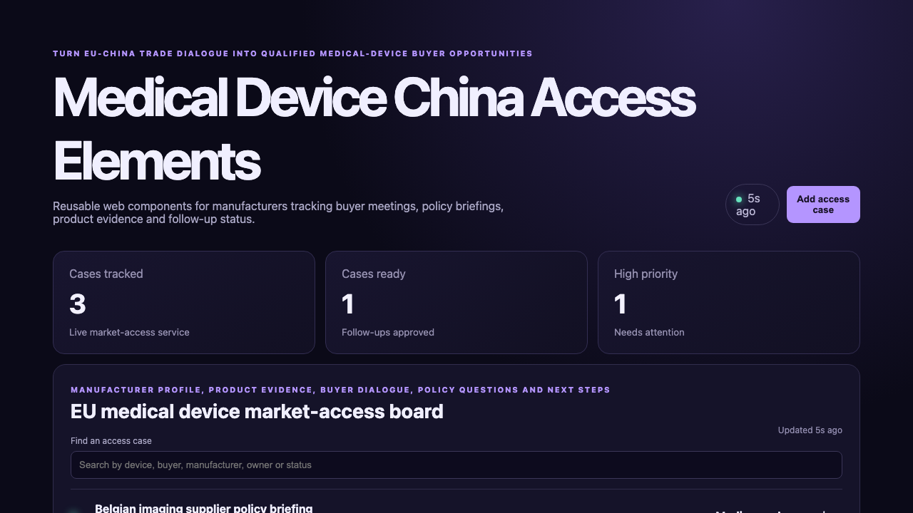

# Medical Device China Access Elements

## One-sentence benefit

Help European medical-device manufacturers turn trade dialogue into qualified Chinese buyer opportunities.

## Live demo

[Watch the workflow](docs/demo.webm).

## Screenshots

## Main features

- Search cases by device, manufacturer, buyer, owner or status.
- Create market-access cases through the Java API.
- Advance cases through evidence review and approval.
- Display loading, empty, error and success feedback.
- Reuse encapsulated metric and workspace components responsively.

## Technology used

Lit, TypeScript, native custom elements, shadow DOM, Vite, Spring Boot and Java 21.

## Installation instructions

Install Node.js 22 and Java 21. Run `npm install`, start the backend with `cd backend && mvn spring-boot:run`, then run `npm run dev`.

## Commercial licensing/contact

Commercial licensing and integration support are available through the repository contact options.

## Business problem and users

Manufacturers, trade advisers, buyer delegations and policy teams need comparable product evidence, meeting ownership and follow-up status.

## Key workflows

Find an access case, create a buyer follow-up, review its owner, advance readiness and inspect updated metrics.

## Lit/Web Components framework highlights

Lit properties drive API state, repeat directives render keyed records, shadow DOM encapsulates styles and custom elements make metrics reusable.

## Java backend highlights

Spring Boot provides validated list, search, create and update endpoints, structured errors, health status and domain tests.

## Architecture and state flow

The custom element fetches `/api/items`; Spring Boot validates data and returns updated market-access cases.

## Accessibility and responsive behaviour

Labelled controls, semantic regions, visible states, keyboard-ready buttons and responsive components support compact and wide layouts.

## Verification commands

Run `npm test`, `npm run build`, `cd backend && mvn test` and `cd backend && mvn package`.

## Structure

`src` contains custom elements, `backend` contains Java and `docs` contains inspected media.

## Tradeoffs

The sample uses in-memory data; production should add verified company profiles, durable records and permission controls.

## Roadmap

Add product catalogues, buyer matching, policy-question tracking, meeting notes and multilingual export packs.
